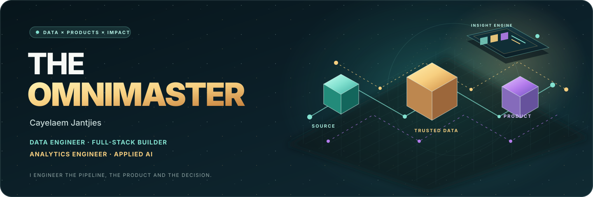
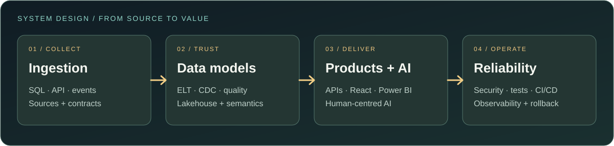
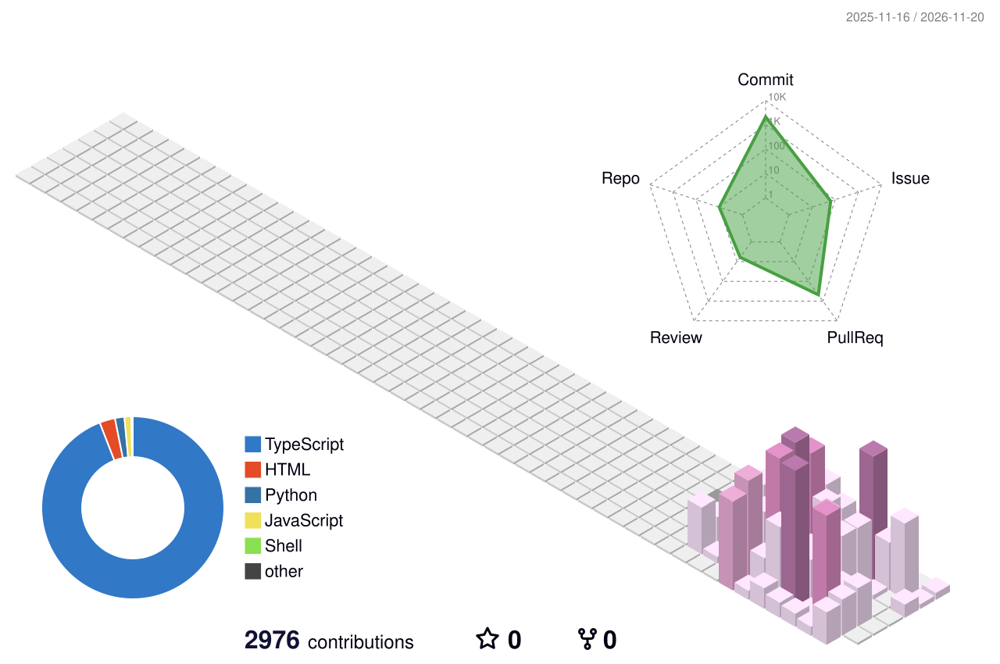
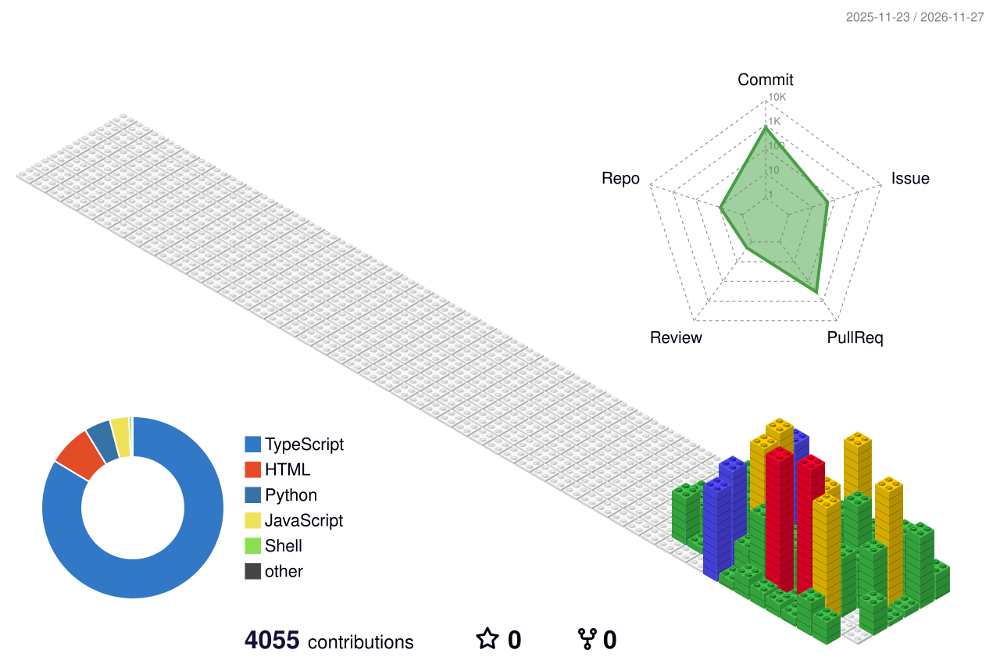
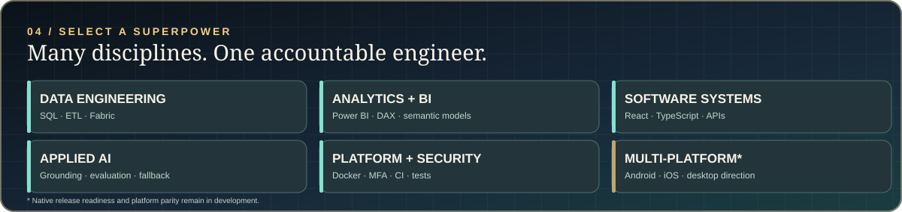

### DATA ENGINEERING  ·  FULL-STACK SYSTEMS  ·  ANALYTICS  ·  APPLIED AI

**Johannesburg, South Africa** · 3+ years building across banking, FMCG, media, manufacturing, agriculture and social impact

[THE WORK](#the-work) · [THE TOOLKIT](#the-toolkit) · [THE 3D GARDEN](#the-3d-garden) · [THE STORY](#the-story) · [THE DEEP DIVE](#the-deep-dive)

---

## I build the whole chain

I don't stop at the chart. I trace the source, engineer the pipeline, model the meaning, build the product, and make the result usable.

| **270M+** | **40%** | **70%** | **4 markets** |
|:--:|:--:|:--:|:--:|
| survey records processed | reported dashboard speed-up | less manual reporting effort | banking analytics delivered |

Historical project outcomes, not live system metrics. Every number is tied to documented work; client-owned source and sensitive data stay private.

  

---

## The work

<table>
  <tr>
    <td width="50%" valign="top">
      <h3>⚡ THE FIXER · NewChanges</h3>
      
<strong>Make operational data move at the speed of the work.</strong>

      
A data integration and analytics platform spanning SQL/API sources, validation, reporting views, dashboards and security controls. I'm building toward CDC-driven updates so users don't have to ask an admin to refresh a dashboard.

      
<strong>Current proof:</strong> source-contract work, replay-safe CDC experiments and disposable MySQL integration checks. Live AWS replication and production CDC are still distinct release gates.

      
      &nbsp;<a href="docs/OMNIMASTER_MISSION_DOSSIERS.md#mission-01--the-fixer-integration-platform">Architecture & decisions →</a>
    </td>
    <td width="50%" valign="top">
      <h3>🎓 CABO LEARNING HUB</h3>
      
<strong>Turn learner data into timely support.</strong>

      
An independent, pro-bono product prototype exploring learner journeys, educator tools, interventions, longitudinal data and carefully bounded AI support.

      
<strong>Design rule:</strong> AI can assist with learning; educators retain review and decision ownership. This is active product development, not a national deployment.

      
      &nbsp;<a href="docs/OMNIMASTER_MISSION_DOSSIERS.md#mission-02--cabo-learning-hub">Education, data & AI →</a>
    </td>
  </tr>
  <tr>
    <td width="50%" valign="top">
      <h3>🏭 MANUFACTURING · AUSTRALIA</h3>
      
<strong>Get the grain right before the chart.</strong>

      
Remote engineering delivery across production, stock, scheduling, dispatch and logistics reporting. Work included SQL Server, Fabric, Power BI, DAX and automation, with hands-on investigation of join duplication, changing schemas and operational data quality.

      
<strong>Reported scope:</strong> eight states, 35 DAX measures and 11 model relationships.

      
    </td>
    <td width="50%" valign="top">
      <h3>📊 ENTERPRISE ANALYTICS</h3>
      
<strong>Make complex business data decision-ready.</strong>

      
Consulting and delivery across banking, capital markets, FMCG and broadcasting: semantic models, market-aware access, reporting automation, customer experience and commercial analytics.

      
<strong>Examples:</strong> FNB, JSE, Diageo, AB InBev, MultiChoice and VKB. Client-owned code and data are not represented as public work.

      
    </td>
  </tr>
  <tr>
    <td width="50%" valign="top">
      <h3>🧭 HUMAN CAPITAL · HR-Software</h3>
      
Recruitment and employee workflows with evidence provenance, permission boundaries and human-reviewed AI drafting. Public prototype uses synthetic data; it is not approved for real applicant records.

      <a href="https://github.com/CayelaemJ/HR-Software">Explore the HR prototype →</a>
    </td>
    <td width="50%" valign="top">
      <h3>🪙 FINANCIAL INTELLIGENCE</h3>
      
Accounting and audit workflows with deterministic double-entry logic, immutable journals and reviewer gates. Gated staging—not certified production accounting software.

      <a href="https://github.com/CayelaemJ/Accounting-Audit-And-Analytics-Software">Explore the finance prototype →</a>
    </td>
  </tr>
</table>

  
<strong>More worlds: artist systems, social impact, predictive analytics and product experiments</strong>

   

  | Build | What it explores | Evidence boundary |
  |:--|:--|:--|
  | [CABO Artist Hub](https://github.com/CayelaemJ/Artist-Management-Hub) | Artist discovery, booking workflows, management dashboards and AI-assisted advice. | Public prototype; fictional records; no live social integration. |
  | [CABO Solutions](https://github.com/CayelaemJ/CABOSOLUTIONS) | React/Three.js site with a Node API and enquiry workflow. | Public product repository. |
  | Jozi My Jozi | Social-outcome capture with Power Apps, SharePoint and Power BI. | Historic volunteer work; sensitive records remain private. |
  | Predictive modelling | Customer churn, forecasting, statistics and exploratory ML. | Independent projects and learning history. |
  | [EFS React Migration](https://github.com/CayelaemJ/EFS-React-Migration) | Frontend migration, UI parity and legacy/current separation. | Supporting repository, not a finished standalone product. |

  CABO work is independent and pro bono: I build prototypes to learn, demonstrate ideas and present to prospective clients.

---

## The toolkit

  

  
  
  
  

<table>
  <tr><td><strong>DATA</strong></td><td>SQL Server · PostgreSQL · MySQL · Python · ETL/ELT · dimensional modelling · data contracts · CDC experiments</td></tr>
  <tr><td><strong>INSIGHT</strong></td><td>Power BI · DAX · Power Query · Microsoft Fabric · semantic models · row-level security · performance tuning</td></tr>
  <tr><td><strong>PRODUCT</strong></td><td>React · TypeScript · Node.js · Fastify/Express · REST APIs · Prisma · responsive and role-aware UX</td></tr>
  <tr><td><strong>DELIVERY</strong></td><td>Docker · GitHub Actions · Playwright · Vitest · security scanning · Render · Cloudflare · AWS experiments</td></tr>
  <tr><td><strong>GROWING INTO</strong></td><td>Solution architecture · Kotlin/Android · iOS · platform reliability and technical leadership</td></tr>
</table>

---

## The 3D garden

I made the contribution graph a little less flat. The profile artwork is generated in this repository and refreshes automatically.

  

  <picture>
    <source media="(prefers-color-scheme: dark)" srcset="./output/github-snake-dark.svg" />
    <source media="(prefers-color-scheme: light)" srcset="./output/github-snake.svg" />
    
  </picture>

  
Switch to the isometric contribution city

  

  
  

  

Stats cards show public GitHub activity and repository metadata. Hosted widgets may occasionally be rate-limited.

---

## How I think

| **01 · GRAIN BEFORE GRAPHS** | **02 · FRESHNESS IS A CONTRACT** | **03 · TESTS ARE EVIDENCE** |
|:--|:--|:--|
| Prove the key, history and join grain before trusting a KPI. | A successful refresh is not the same as change data capture. | A green suite proves its tested paths—not production readiness. |

---

## The story

<table>
  <tr><td><strong>2023</strong></td><td>BCom, Statistics and Data Science · University of Pretoria</td><td>Quantitative foundations</td></tr>
  <tr><td><strong>2024</strong></td><td>Enterprise BI and consulting</td><td>Banking, capital markets, FMCG and media</td></tr>
  <tr><td><strong>2025</strong></td><td>Analytics at scale and cross-industry delivery</td><td>Source modelling, performance and automation</td></tr>
  <tr><td><strong>2026</strong></td><td>Remote manufacturing engineering and full-stack product work</td><td>Applications, security, applied AI, cloud and CI/CD</td></tr>
</table>

I’m growing toward solution architecture and technology leadership. My strongest fit is work where **data, software and business decisions meet**—with enough ownership to follow a problem from source to release.

---

## The deep dive

Want the full technical autobiography? Pick a door:

| **THE OMNIMASTER LIBRARY** | **ENGINEERING PRACTICE** | **LEARNING & PLAY** |
|:--|:--|:--|
| [Handbook: my story and ten chapters](docs/OMNIMASTER_HANDBOOK.md) [Mission dossiers](docs/OMNIMASTER_MISSION_DOSSIERS.md) [Client case studies](docs/CLIENT_CASE_STUDIES.md) [Project atlas](docs/PROJECT_PORTFOLIO.md) | [Field guide: architectures and incidents](docs/OMNIMASTER_FIELD_GUIDE.md) [System design](docs/OMNIMASTER_SYSTEM_DESIGN.md) [Engineering journal](docs/ENGINEERING_FIELD_NOTES.md) [Reproduce the labs](projects/README.md) | [Academy](docs/OMNIMASTER_ACADEMY.md) [Build with me](docs/OMNIMASTER_BUILD_WITH_ME.md) [Human interface & UI/UX](docs/OMNIMASTER_HUMAN_INTERFACE.md) [Reliability guide](docs/OMNIMASTER_RELIABILITY_FIELD_GUIDE.md) [Arcade](docs/OMNIMASTER_ARCADE.md) |

**[Explore the live OmniMaster portfolio →](https://omnimaster-portfolio.onrender.com)**  
Interactive project stories, a guided recruiter tour, engineering challenges and a technical arcade. GitHub displays the evidence; the portfolio is where you can play with it.

---

## ONE MIND. EVERY LAYER.

**[PORTFOLIO](https://omnimaster-portfolio.onrender.com)** · **[LINKEDIN](https://www.linkedin.com/in/cayelaem-jantjies-000b45144/)** · **[EMAIL](mailto:cay.jantjies1703@gmail.com)** · **[ALL REPOSITORIES](https://github.com/CayelaemJ?tab=repositories)**

Historical results are attributed to their engagements. Prototypes, pilots, simulations and future capabilities are labelled as such.

