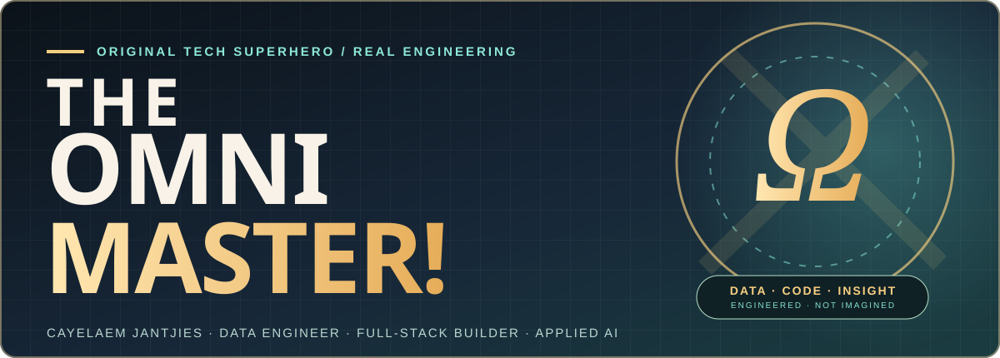
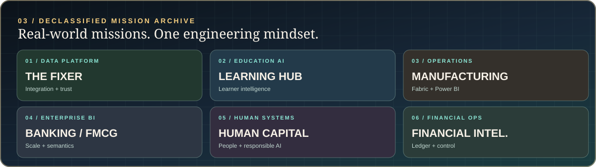
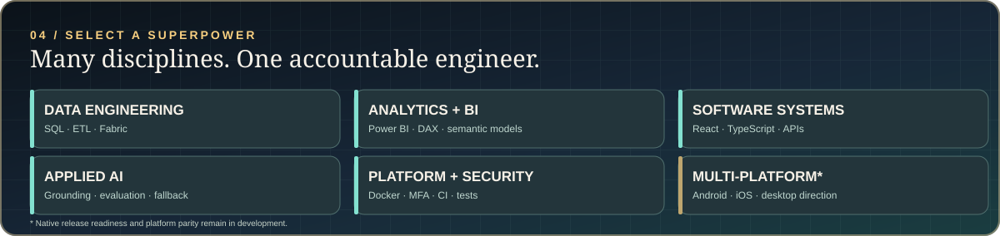
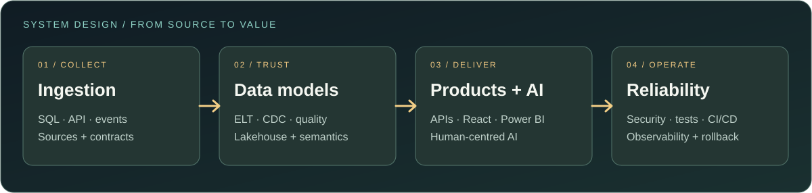
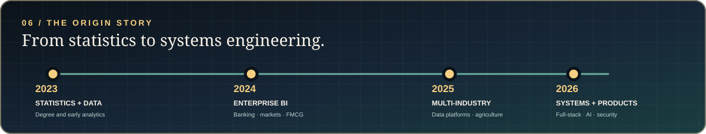

<strong>THE OMNIMASTER LIBRARY</strong> · My engineering life in seven volumes, a hands-on Academy, runnable systems, and a technical arcade.

 

**DATA ENGINEERING** · **FULL-STACK SYSTEMS** · **UI/UX DEVELOPMENT** · **BUSINESS INTELLIGENCE** · **APPLIED AI** · **DEVSECOPS**

Johannesburg, South Africa · 3+ years of engineering delivery · Building toward solutions architecture and technical leadership

<table>
<tr>
<td width="200" align="center" valign="middle">
  
</td>
<td valign="middle">
  <h2>Under the suit: Cayelaem Jantjies.</h2>
  
I'm a data engineer, analytics specialist, UI/UX developer and full-stack builder. I don't stop when a dashboard renders or a screen looks polished: I work through <strong>source systems, ingestion, transformation, application design, APIs, access controls, testing and deployment</strong> so people can understand, use and trust the result.

  
I have delivered across banking, FMCG, media, manufacturing, agriculture and social impact, including remote engineering for an Australian manufacturing business. Alongside client work, I develop independent products through CABO Solutions and The Fixer.

  
<strong>My advantage:</strong> I can discuss the business problem, locate the problem in the SQL, adjust the API, redesign the UI, investigate the failing test and help ship the release.

  
<a href="https://omnimaster-portfolio.onrender.com">See the full visual portfolio and interactive experiences →</a>

</td>
</tr>
</table>

> **THE OMNIMASTER PRINCIPLE:** One mind, every layer. The alter ego is fictional. The engineering, decisions, bugs and lessons are real.

---

## Open the book | A deeper look at my work

**[VOLUME I · THE OMNIMASTER HANDBOOK: MY STORY AND TEN TECHNICAL CHAPTERS →](docs/OMNIMASTER_HANDBOOK.md)**

**[VOLUME II · THE ENGINEERING FIELD GUIDE: ARCHITECTURES, INCIDENTS AND WORKED EXERCISES →](docs/OMNIMASTER_FIELD_GUIDE.md)**

**[VOLUME III · THE OMNIMASTER ACADEMY: LEARN THE SKILLS AND BUILD THE SYSTEMS →](docs/OMNIMASTER_ACADEMY.md)**

**[VOLUME IV · THE PERSON BEHIND THE CODE: INTJ, SYSTEMS THINKING AND MY RANGE ACROSS IT →](docs/OMNIMASTER_OPERATING_MANUAL.md)**

**[VOLUME V · BUILD A SYSTEM WITH ME: SOURCE EVENTS TO TRUSTWORTHY DECISIONS →](docs/OMNIMASTER_BUILD_WITH_ME.md)**

**[VOLUME VI · THE HUMAN INTERFACE: MY UI/UX DEVELOPMENT JOURNEY AND DESIGN FOR PEOPLE →](docs/OMNIMASTER_HUMAN_INTERFACE.md)**

**[VOLUME VII · RELIABILITY ENGINEERING: RETRIES, RECOVERY AND TRUTHFUL UX →](docs/OMNIMASTER_RELIABILITY_FIELD_GUIDE.md)**

**[THE OMNIMASTER ARCADE · PUZZLES, TECHNICAL QUESTS AND A PLAYABLE PYTHON GAME →](docs/OMNIMASTER_ARCADE.md)**

**[30-DAY ENGINEERING EXPEDITION · A DAY-BY-DAY STUDY PLAN →](docs/THIRTY_DAY_ENGINEERING_EXPEDITION.md)**

**[LAUNCH THE LIVE STUDY ROOM · READ EVERY LESSON ON THE WEBSITE →](https://omnimaster-study-room.cabo-solutions-za.workers.dev/)**

**[SEARCH ALL 54 LEARNING PAGES · INTERACTIVE COURSE CATALOGUE →](https://omnimaster-study-room.cabo-solutions-za.workers.dev/library)**

The Study Room has a branded link preview for sharing the public learning website on LinkedIn or in messages. The preview links to the actual site, not a GitHub HTML source viewer.

**[STUDY FRONTEND VS BACKEND · INTERACTIVE HTML BOOK →](https://omnimaster-study-room.cabo-solutions-za.workers.dev/OMNIMASTER_FULLSTACK_PLAYBOOK.md)**

**[DOWNLOAD THE FULL-STACK PDF EDITION →](https://omnimaster-study-room.cabo-solutions-za.workers.dev/downloads/omnimaster-fullstack.pdf)**

Public learning is served directly from the site. Source review is separate: [access and visibility policy](docs/ACCESS_AND_SHARING.md).

[Inspect the Study Room HTML source](docs/interactive/index.html) · No account or tracking · Optional progress stays in your browser.

> **Where I fit:** Across most software-oriented IT environments, from SQL and analytics through applications, AI integration, quality, security-conscious delivery and cloud/platform work. **Hardware engineering and physical device repair aren't my focus.** Breadth is my advantage; I still respect the depth each specialist discipline requires. [See the evidence and limits](docs/personal/03_IT_RANGE_AND_LIMITS.md).

Not another list of frameworks. This is my technical autobiography: **where I started, the organisations and systems I've worked with, the failures that taught me something, how I design trustworthy data and software, and what you can run yourself**.

| **PART I · The person & the journey** | **PART II · Engineering practice** |
|---|---|
| [01 · The engineer behind the systems](docs/handbook/01_THE_ENGINEER.md) | [04 · Data engineering discipline](docs/handbook/04_DATA_ENGINEERING.md) |
| [02 · From statistics to full-stack ownership](docs/handbook/02_THE_CAREER.md) | [05 · BI and analytics engineering](docs/handbook/05_ANALYTICS_ENGINEERING.md) |
| [03 · Systems in the wild: real case studies](docs/handbook/03_SYSTEMS_IN_THE_WILD.md) | [06 · Software products and responsible AI](docs/handbook/06_PRODUCTS_AND_AI.md) |

| **PART III · Reliability, evidence & direction** | **What's inside** |
|---|---|
| [07 · Security, testing and release engineering](docs/handbook/07_SECURITY_AND_DELIVERY.md) | Real trust boundaries and honest release gates |
| [08 · Reproduce the work](docs/handbook/08_REPRODUCE_THE_WORK.md) | Four synthetic engineering labs and executable tests |
| [09 · Leadership and where I'm going](docs/handbook/09_LEADERSHIP_AND_NEXT.md) | Delivery philosophy and solution-architecture ambitions |
| [10 · Glossary and evidence register](docs/handbook/10_GLOSSARY_AND_EVIDENCE.md) | Verify the terms, metrics and project maturity |

READING GUIDE: [90-second introduction](docs/handbook/01_THE_ENGINEER.md) · [Technical deep dive](docs/handbook/04_DATA_ENGINEERING.md) · [Working code](projects/README.md) · [Full bibliography and claim register](docs/handbook/10_GLOSSARY_AND_EVIDENCE.md).

### Inside Volume II · Explore how I actually engineer things

| Read | What it shows |
|---|---|
| [**The architecture atlas**](docs/field-guide/01_ARCHITECTURE_ATLAS.md) | Five visual reference architectures covering source-to-dashboard, secure APIs, applied AI and releases |
| [**The debugging casebook**](docs/field-guide/02_DEBUGGING_CASEBOOK.md) | Six investigations with symptoms, hypotheses, safe experiments and regression requirements |
| [**The engineering workbook**](docs/field-guide/03_ENGINEERING_WORKBOOK.md) | Seven worked exercises in SQL, CDC, access control, AI and reliability |
| [**Role and evidence map**](docs/field-guide/04_ROLE_AND_EVIDENCE_MAP.md) | What I offer as a data, analytics, backend, AI or architecture-track engineer |
| [**Architecture decision journal**](docs/field-guide/05_DECISION_JOURNAL.md) | Six explicit trade-off records, including migration and security gates |

**[OPEN THE FULL FIELD GUIDE →](docs/OMNIMASTER_FIELD_GUIDE.md)**

### Start studying or find out how I think

| Start here | What you'll find |
|---|---|
| [**Academy: seven lessons**](docs/OMNIMASTER_ACADEMY.md) | SQL, CDC, backend systems, applied AI, security, CI and three capstones |
| [**My INTJ perspective**](docs/personal/01_INTJ_AND_ME.md) | The useful habits, blind spots and limits of the label |
| [**Why I think in systems**](docs/personal/02_WHY_I_THINK_IN_SYSTEMS.md) | How statistics, BI, manufacturing and software shaped my decisions |
| [**My range across IT**](docs/personal/03_IT_RANGE_AND_LIMITS.md) | What I have done, where I can contribute, and where I need specialist growth |
| [**How to work with me**](docs/personal/04_COLLABORATION_AND_QUIRKS.md) | The collaboration guide, curiosities and non-negotiables |
| [**Play Incident Academy**](projects/omnimaster-incident-academy/) | Eight offline engineering detective challenges, explained in code |
| [**Build an event-to-decision platform**](projects/data-to-decision-platform/) | A complete, synthetic SQLite source-to-Bronze/Silver/Gold simulation with transaction and replay tests |
| [**30 days of learning by doing**](docs/THIRTY_DAY_ENGINEERING_EXPEDITION.md) | Thirty daily assignments with expected artifacts and pass criteria |
| [**Live interactive Study Room**](https://omnimaster-study-room.cabo-solutions-za.workers.dev/) | A usable browser experience, with technical questions and optional browser-local progress |
| [**UI/UX and human-centred design**](docs/OMNIMASTER_HUMAN_INTERFACE.md) | Six chapters about my interface work, usability, design systems, accessibility and user research |

---

[**MISSIONS**](#03--declassified-mission-archive) · [**POWER MATRIX**](#04--the-power-matrix) · [**SYSTEM ARCHITECTURE**](#05--how-i-engineer-systems) · [**WORLDS**](#06--the-industries-ive-worked-across) · [**ORIGIN**](#07--the-origin-story) · [**CURRENT LAB**](#08--what-im-building-and-testing-now) · [**CHALLENGES**](#09--the-danger-room) · [**CONTACT**](#10--work-with-me)

---

## 01 / The person behind the systems

My professional background started in statistics and data analysis, but the problems I kept encountering never ended at the report. A broken data source meant tracing the extraction. An expensive dashboard meant fixing the model. A fragile process meant building automation. A product requirement meant touching the frontend, API, database and release pipeline.

Today, my work combines four overlapping responsibilities:

| What I own | What that means in practice |
|:--|:--|
| **Data platforms** | Understand source contracts; model and move data with SQL, Python, ETL/ELT and modern analytical platforms; investigate quality and performance. |
| **Decision systems** | Build Power BI semantic models, DAX measures, row-level security, operational KPIs and analytical experiences that people can actually interpret. |
| **Software products** | Build interfaces, backend routes, database models, integrations, tenant-aware permissions, product workflows and user journeys. |
| **Trust and delivery** | Test the application, review security boundaries, automate CI, manage deployment risks and document what remains unverified. |

**What I value:** useful software, source-level correctness, an honest delivery status, privacy and security controls that are testable, and stakeholder communication that does not hide behind technical jargon.

**Where I am heading:** hands-on solution architecture, principal engineering and technology leadership. I'm interested in roles where data, products, AI and engineering execution intersect.

---

## 02 / Proof of work, not just buzzwords

| **270M+** | **40%** | **Up to 70%** | **4 markets** |
|:--:|:--:|:--:|:--:|
| Survey records processed and visualised | Reported dashboard load-time improvement | Reduction in manual reporting effort | Banking reporting across African markets |

These are historical project outcomes from my documented professional experience, **not live usage statistics or independent production benchmarks**. Behind the numbers were data modelling, semantic-layer tuning, business rules, workflow automation and debugging source systems.

Other documented project scope includes **18 banking dashboards**, an Australian scheduler solution covering **eight states**, **35 DAX measures**, **11 model relationships**, and a **15-temporary-table SQL design**. These are reported engagement characteristics, not a claim that all source code can be published.

[**Read the real client and project case studies →**](docs/CLIENT_CASE_STUDIES.md)

### Reproducible engineering labs

Want to inspect working code rather than read another list of tools? These two small, dependency-free projects contain synthetic demos, executable Python and unit tests:

- **[CDC Replay Lab](projects/cdc-replay-lab/)**: ordered change events, deduplication, deletion tombstones, atomic replay and Bronze/Silver/Gold projections.
- **[Data Quality Contracts](projects/data-quality-contracts/)**: ingestion-time schema, duplicate-key, decimal and timestamp/freshness checks with machine-readable findings.
- **[SQL Query Plans](projects/sql-query-plans/)**: inspect full scans versus composite-index range searches with 2,400 synthetic records and explain query shape.
- **[Offline AI Output Evaluation](projects/ai-output-evaluation/)**: enforce extractive source references and human-review flags using synthetic, testable failure cases.

All four are intentionally local, tested educational examples, **not deployed production systems, complete AI safety evaluations or compliance certifications**. [Browse the project index](projects/README.md).

---

## 03 / Declassified mission archive

**The work is varied, but the core question is the same:** how do I turn a messy real-world problem into a reliable, secure and understandable system? Each mission below includes its purpose, technical choices and limitations.

### MISSION 01 · The Fixer: integration, analytics and the machinery behind the UI

**[Explore the code: NewChanges](https://github.com/CayelaemJ/NewChanges)** · **Status: substantial application with ongoing integrations, security hardening and controlled migration work**

**The problem.** Organisations need to bring SQL views, APIs and files into governed reporting without losing source semantics, tenant isolation or control over administration. Simply copying records into another database creates little value if downstream dashboards remain stale or inconsistent.

**What I have been engineering**

- A **TypeScript / Fastify / PostgreSQL / Prisma** application, with the existing dashboard and a separate React modernisation path. Tenant-aware employer, portfolio and administrative experiences are part of the documented architecture.
- A documented **ten-feed source contract** spanning operational SQL views, APIs and file-based inputs, with reporting definitions, metadata and incremental-load considerations.
- **MySQL reporting and AWS CDC simulation experiments** to explore more direct change-to-dashboard propagation, source timestamps, nullable watermarks, idempotency and refresh semantics.
- Security work around **admin TOTP/WebAuthn MFA**, sensitive-operation step-up, recovery, server-side validation, email-address handling, audit trails and synthetic-data controls.
- **Disposable Docker test environments, Playwright/Vitest checks and self-hosted CI** so testing does not depend on production databases or paid external services.

**The engineering trade-off:** a second store or transformation hop is not automatically useful. I prefer a clear source contract, transformation ownership and measured latency over validation duplicated at every boundary.

**What still needs evidence:** MFA coverage across deployed sensitive routes, complete CDC/update-to-dashboard propagation, production data migration parity, cutover approval and rollback rehearsals. **A green test or staging branch is not a production sign-off.**

**Deep dive:** [Integration architecture, security and decisions](docs/OMNIMASTER_MISSION_DOSSIERS.md#mission-01--the-fixer-integration-platform)

### MISSION 02 · CABO Learning Hub: intelligence across the learner journey

**[Explore the code: Training-and-Development-Hub](https://github.com/CayelaemJ/Training-and-Development-Hub)** · **Status: active development, demonstrable workflows and pilots; not a national deployment**

**The problem.** A learner's needs are broader than quizzes, content and term marks. Schools and families also need assessment history, interventions, progression, educator support and a way to connect information across years or institutions.

**What I have been designing and implementing**

- Document and learning-material ingestion; **multiple-choice and written examinations** using source-grounded questions, rubrics, partial-credit AI marking, feedback and review flags, as documented by the repository.
- Learner, educator, guardian, institution and administrator journeys with distinct permissions and suitable interfaces for different ages and responsibilities.
- A longer-term **longitudinal learner profile**, with school-system onboarding, historical marks migration, interventions and school/district reporting rather than treating the system as a conventional LMS.
- **Applied AI provider routing** and failure behaviour: Groq/Hugging Face exploration, evaluation, latency/cost awareness, fallback, privacy and explicit human review.
- A multi-platform direction for **web, Android/Kotlin, iOS and desktop**, with real native experiences rather than assuming a web wrapper is equivalent.

**The engineering trade-off:** AI can help educators, but it should not silently turn a model's prediction into an official mark or learner intervention. Source evidence, consent, roles, bias evaluation and educator oversight are non-negotiable design concerns.

**What is not yet complete:** national or government integration, independently approved child-data processing and full native app feature parity. Botswana expansion and system replacement are **product goals**, not signed public-sector deployments.

**Deep dive:** [Education workflows, data migration and AI governance](docs/OMNIMASTER_MISSION_DOSSIERS.md#mission-02--cabo-learning-hub)

### MISSION 03 · Australian manufacturing: get the grain right before the chart

**Professional engagement: Bitberry / Bestbar, remote Australian manufacturing delivery** · **Status: historical delivered client work, proprietary source**

**The problem.** Production, workforce scheduling, dispatch, stock and deliveries came from operational systems with changing schemas, inconsistent keys and different measurement grains. Joining the wrong tables can make a perfectly polished dashboard report incorrect figures.

**What I did**

- Delivered SQL Server, Microsoft Fabric, Power BI, DAX and Power Automate reporting as a primary data engineering resource across operational manufacturing datasets.
- Built a scheduler-performance model described in my CV across **eight Australian states**, using **15 SQL temporary tables, 35 DAX measures and 11 model relationships**.
- Worked on rebar and mesh production, scrap and cutting, stock forecasting, workforce output, dispatch and logistics reporting.
- Investigated **SQL deadlocks**, cascading dataflow failures, dynamic-pivot column drift, manifest versus schedule grain, duplicated joins and durations stored in inconsistent units.
- Automated recurring reports and document-handling flows, including mill-certificate processing.

**Example decision:** before measuring deliveries per driver, first prove which record represents a schedule, which represents a manifest line, and how a truck/driver assignment behaves over time. Otherwise a one-to-many join multiplies tonnage or cost.

**Evidence boundary:** detailed client data and internal systems are not public. This is an experience case study, not a downloadable source repository.

[**Read the manufacturing case study →**](docs/CLIENT_CASE_STUDIES.md#1-bitberry--bestbar--australia-data-platform-manufacturing-and-delivery-analytics)

### MISSION 04 · Enterprise BI: 270 million rows are useless without trusted measures

**Professional consulting across banking, capital markets, FMCG and broadcasting** · **Status: historical engagements; client-owned work**

- **FNB:** commercial and retail analytics across **South Africa, Namibia, Botswana and Zambia**; an **18-dashboard** body of work, model and DAX optimisation, market-specific access and a reported **40% dashboard load-time improvement**.
- **Diageo:** worked with a reported **270M+ survey-row** dataset for brand and market performance. Data quality, query design, semantic modelling and insight communication mattered as much as visual design.
- **JSE:** SLA/service reporting and Jira extraction workflows, with a reported **up to 70% reduction** in recurring manual reporting.
- **AB InBev:** commercial analytics and Microsoft Fabric/BI reporting across African markets.
- **MultiChoice:** customer-experience reporting, NPS, service patterns, sentiment and broadcast operations.
- **VKB:** ERP/NAV and warehouse staging, SQL/MDX analytics, Power Platform and reporting modernisation.

**The engineering trade-off:** optimise the SQL and semantic layer, not just the visuals. Respect historical dates, denominators, dynamic RLS, data completeness and row-level grain when designing executive metrics.

[**Client-by-client engineering stories →**](docs/CLIENT_CASE_STUDIES.md)

### MISSION 05 · CABO Human Capital: responsible decisions need evidence

**[Explore the code: HR-Software](https://github.com/CayelaemJ/HR-Software)** · **Status: active product development and synthetic-data demonstration**

Building a React/TypeScript/Express/PostgreSQL foundation for recruitment, employer/candidate journeys, employee operations, performance management and accountable decision support. The interesting engineering challenges include **tenant data boundaries, audit trails, evidence provenance, CV retention, human-controlled AI drafting and fairness evaluation**.

An AI ranking or recommendation should not quietly become an employment decision. Permission checks, meaningful explanations and human review are product requirements, not optional polish. The current demonstration is **not approved for real applicant data or as a regulated payroll replacement**.

[**Deep dive: Human Capital and data ethics →**](docs/OMNIMASTER_MISSION_DOSSIERS.md#mission-05--cabo-human-capital)

### MISSION 06 · CABO Financial Intelligence: trustworthy financial operations

**[Explore the code: Accounting-Audit-And-Analytics-Software](https://github.com/CayelaemJ/Accounting-Audit-And-Analytics-Software)** · **Status: gated staging, not certified production accounting software**

Developing a modular **Next.js / TypeScript / PostgreSQL** platform covering organisation access, **exact-decimal double-entry ledgers, immutable journals, invoices, bank CSV matching, budgets, management reports, audit controls and reviewer gates**.

A noteworthy design choice is to keep financial posting **deterministic and transactional**. AI may explain a read-only report, but it should not silently change accounting records. The project documentation explicitly identifies missing tax/year-end, evidence-storage and live bank-feed capabilities.

[**Deep dive: financial correctness and controls →**](docs/OMNIMASTER_MISSION_DOSSIERS.md#mission-06--cabo-financial-intelligence)

<strong>+ Open additional missions: social impact, artist systems, CABO products, predictive analytics and more</strong>

 

| Work / product | What it demonstrates | Evidence or status |
|:--|:--|:--|
| **[CABO Artist Hub](https://github.com/CayelaemJ/Artist-Management-Hub)** | Artist discovery, booking enquiries, synthetic PR/career-health indicators, management dashboards and AI advice with fallback. | Public prototype; fictional records; not live social integration. |
| **[CABO Solutions website](https://github.com/CayelaemJ/CABOSOLUTIONS)** | React/Vite/Three.js frontend with a Node API and persisted enquiry workflow. | Public product repository. |
| **Jozi My Jozi** | Shelter and social-outcome capture using Power Apps, SharePoint and Power BI, with practical staff training. | Historic volunteer work; sensitive records private. |
| **Predictive modelling** | Customer churn, forecasting, Python/R statistics and exploratory ML experiments. | Individual work and learning history; not all code available. |
| **Botswana commerce** | E-commerce, bookings, business-process automation and customer experience. | Independent private/product experiments; no public source claimed. |
| **[EFS React Migration](https://github.com/CayelaemJ/EFS-React-Migration)** | Frontend migration direction, UI parity and separation of legacy/current systems. | Supporting repository, not a finished standalone product. |
| **[Testing-EFS](https://github.com/CayelaemJ/Testing-EFS)** | Historical integration, product and quality workstreams. | Supporting/legacy snapshot. |
| **[OmniMaster portfolio](https://omnimaster-portfolio.onrender.com)** | An interactive, responsive work history with an engineering journal and recruiter-friendly exploration. | Public portfolio, includes games and guided project sections. |

For the larger catalogue, see the [project atlas](docs/PROJECT_PORTFOLIO.md). A public description does not imply a private repository or client dataset is accessible.

---

## 04 / The power matrix

I work across multiple disciplines, but **not every technology represents the same maturity or depth**. Here is how those capabilities come together in actual delivery.

| Discipline | Hands-on work | What it looks like in practice |
|:--|:--|:--|
| **Data engineering** | SQL Server/T-SQL, PostgreSQL, MySQL, ETL/ELT, Fabric, source validation, dimensional models, API/file ingestion | Trace incorrect data, model sources, plan transformations, measure refresh and query behaviour. |
| **Analytics engineering and BI** | Power BI, DAX, Power Query, RLS, report performance and semantic models | Reliable KPIs, access-aware measures, historical comparisons and executive decision support. |
| **Full-stack software** | React, TypeScript, JavaScript, Node.js, Express/Fastify, Prisma and REST | From database design to authentication, API contracts, mobile-responsive interfaces and deployment. |
| **Applied AI and data science** | Python, pandas, statistical modelling, ML experiments, model integrations, grounded assessments | Helpful product features with source grounding, evaluation, fallback and review. |
| **Automation / DevSecOps** | Power Automate, Docker, CI/CD, self-hosted runners, Playwright, Vitest, Semgrep/Trivy/Gitleaks | Replace repetitive tasks and build confidence before releases. |
| **Cloud and native pathways** | Render, Cloudflare, AWS experimentation, React web, Kotlin Android and iOS planning | Practical hosting and careful migration; native parity remains a verification target. |

<strong>+ Technical tools and the evidence behind them</strong>

 

**Languages, databases and modelling:** Python, SQL/T-SQL, PostgreSQL, MySQL, JavaScript/TypeScript, R, pandas, PySpark, Prisma, dimensional modelling and data contracts.

**BI and modern analytics:** Power BI, Power Query M, DAX, Microsoft Fabric, SQL Server, data warehousing, reporting automation, and experience/training with Databricks and PySpark.

**Applications and infrastructure:** React, Node.js, Fastify/Express, REST APIs, Docker, Render, Cloudflare, GitHub, local CI and API integrations.

**Quality and security:** Vitest, Playwright, SAST, secrets/dependency scans, TOTP and WebAuthn workstreams, RBAC/RLS, privacy-aware design, contract and regression testing.

**Development paths:** Kotlin/Android, iOS and desktop application workflows are evolving capabilities. I do not describe unapproved native releases as shipped.

[Open the comprehensive evidence matrix](docs/TECHNICAL_SKILLS.md).

---

## 05 / How I engineer systems

The platform matters less than the engineering boundaries. Every pipeline or application needs a clear contract, owner, recovery path and consumer.

| Stage | Questions I ask | Examples |
|:--|:--|:--|
| **01 / Source** | What is the real event, natural key, history, timestamp precision and grain? | ERP/NAV, SQL, MySQL reporting views, APIs, documents and files. |
| **02 / Transform** | Where should validation happen? Does an incremental load miss updates or deletes? | ETL/ELT, transformation SQL, lakehouse patterns, CDC simulations, semantic modelling. |
| **03 / Serve** | What should the consumer actually see? How are access and historical semantics enforced? | Power BI/DAX, React dashboards, tenant-aware APIs, AI-assisted workflows. |
| **04 / Operate** | How do we prove this is safe to ship? What happens on a replay, failure or rollback? | Docker CI, MFA, test suites, migrations, health checks, audit trails and monitoring. |

### Selected problems and decisions

<strong>01. I prefer correcting the data grain to correcting the chart.</strong>

In manufacturing and logistics work, joining schedules, deliveries, manifests and workforce tables at incompatible grains can multiply output measures. The right fix starts with the business event and relationship model, validates keys and timing, then creates measures with explicit filter semantics. It is a data problem first, a DAX problem second.

<strong>02. A dashboard refresh is not a CDC guarantee.</strong>

For The Fixer, I am exploring source-change simulation and MySQL reporting integration. Timestamp precision, nullable watermarks, deletes, retries, ordering and idempotency matter. A read-only view can be a useful contract, but a full change-stream design also needs replay handling, monitoring and evidence of actual propagation to consumers.

<strong>03. Avoid validation that doesn't add protection.</strong>

Multiple application and database layers can validate the same field differently and create stale or inconsistent states. I prefer clearly owned contracts, deterministic database constraints, domain validation at appropriate boundaries and observable failures, rather than duplicating checks without purpose.

<strong>04. A green test doesn't certify production.</strong>

I favour synthetic tests in isolated local Docker environments, reliable CI reporting, integration checks against real HTTP routes, role-specific negative tests, migrations rehearsed in staging, and an explicit rollback plan. CI results, application security and production readiness are different questions.

[**Technical design decisions and failure modes →**](docs/OMNIMASTER_SYSTEM_DESIGN.md)

---

## 06 / The industries I've worked across

| World | Delivery focus | Example experience |
|:--|:--|:--|
| **Banking and financial services** | Commercial/retail analytics, market-aware permissions, financial-wellness operations | FNB, financial-wellness engineering |
| **Capital markets** | Service-level analytics and workforce reporting | JSE |
| **FMCG, retail and agriculture** | Large-scale survey analytics, commercial measures, ERP and warehousing | Diageo, AB InBev, VKB |
| **Broadcasting and media** | Customer experience, NPS, sentiment and operational metrics | MultiChoice |
| **Manufacturing and logistics** | Production, scheduling, scrap, stock and dispatch automation | Remote Australian manufacturing |
| **Social impact and education** | Outcome capture, learner intelligence, responsibly applied AI | Jozi My Jozi, CABO Learning Hub |

The same architectural problems appear in different disguises: source lineage, changing schemas, confusing metrics, permissions, workflow design and adoption. I adapt the solution to the operational context, not the other way around.

---

## 07 / The origin story

**Education:** BCom in Statistics and Data Science, University of Pretoria (2023).

| Period | Focus | What changed in my engineering |
|:--|:--|:--|
| **2023** | Statistical foundations, early analytics and broadcast operations exposure | Learned to frame problems quantitatively and handle operational source data. |
| **2024** | Enterprise BI and consulting engagements | Built DAX, Power BI, SQL and reporting automation across banking, capital markets, FMCG and media. |
| **2025** | Analytics at scale, agriculture, nonprofit and independent projects | Deepened source modelling, industry adaptation, reporting performance and delivery ownership. |
| **2026** | Remote manufacturing data engineering; full-stack products and platform work | Expanded into application architecture, security, applied AI, DevOps, cloud and multi-platform product design. |

I have worked as a consultant, delivery engineer, analyst, developer and sole engineering resource on projects. I am most interested in roles where I can **own a complete technical problem and grow toward architecture and leadership** rather than only maintain isolated dashboards.

[**Full documented professional engagements →**](docs/CLIENT_CASE_STUDIES.md)

---

## 08 / What I'm building and testing now

ENGINEERING JOURNAL · NOVEMBER 2026 · WORK IN PROGRESS, NOT A CLAIM OF FINISHED RELEASES

| Workstream | Why it matters | Current engineering questions |
|:--|:--|:--|
| **The Fixer / MFA** | High-risk admin actions require stronger identity proofs. | TOTP/WebAuthn enrolment and recovery, step-up enforcement, complete route coverage and production wiring. |
| **AWS / MySQL CDC lab** | Reporting should reflect meaningful source changes without unnecessary copy cycles. | Watermarks, timestamp granularity, changed rows, deletes, batch/replay rules, view-to-dashboard latency. |
| **PostgreSQL and cloud migrations** | Avoid destabilising live systems during infrastructure changes. | Schema/security parity, staged cutovers, backups, rollbacks and Render/Cloudflare integration. |
| **Self-hosted quality gates** | Tests should be reproducible and isolated from expensive external services. | Docker-based integration suites, local databases, browser checks, scanning and failure reporting. |
| **Learning Hub AI** | Helpful learning support needs reliability and safeguards. | Document grounding, provider fallback, educator review, child-data policy and scale. |
| **Native product development** | Genuine cross-platform delivery needs more than responsive CSS. | Android/Kotlin and iOS implementation, accessibility, parity and real device testing. |

**My current technical mindset:** understand the failure path first, run isolated experiments, document the evidence, then choose the least risky release path.

[Engineering journal](docs/ENGINEERING_FIELD_NOTES.md) · [Detailed mission dossiers](docs/OMNIMASTER_MISSION_DOSSIERS.md) · [System design](docs/OMNIMASTER_SYSTEM_DESIGN.md)

---

## 09 / The danger room

The OmniMaster website has interactive engineering challenges and mini-games. GitHub READMEs cannot safely run custom JavaScript, so this is the launchpad, not a fake embedded game.

| Challenge | What it exercises | Where |
|:--|:--|:--|
| **Engineering scenario challenge** | Source truth, analytics logic, architecture and trade-offs | [Launch the danger room](https://omnimaster-portfolio.onrender.com/#play) |
| **Memory match / reaction / tic-tac-toe** | A little personality between engineering case studies | [Open the OmniMaster arcade](https://omnimaster-portfolio.onrender.com/#omni-arcade) |
| **Recruiter exploration** | Browse my experience through different engineering lenses | [Explore the interactive recruiter tour](https://omnimaster-portfolio.onrender.com/#recruiter-tour) |

These experiences are optional. The main portfolio and linked dossiers contain the technical evidence without needing to play anything.

---

## 10 / Work with me

I'm a **hands-on South African data and software engineer** building toward solution architecture and technology leadership. I'm interested in complex data platform problems, analytics engineering, Fabric/Power BI, full-stack platform development, applied AI and high-ownership engineering roles.

You can see my complete project evidence, interact with the portfolio, inspect public code and contact me below. Where source belongs to a client or a private product, I describe architecture and outcomes without exposing protected information.

### ONE MIND. EVERY LAYER.

**[EXPLORE OMNIMASTER](https://omnimaster-portfolio.onrender.com)** · **[PROJECT ATLAS](docs/PROJECT_PORTFOLIO.md)** · **[ENGINEERING DOSSIERS](docs/OMNIMASTER_MISSION_DOSSIERS.md)** · **[READ THE HANDBOOK](docs/OMNIMASTER_HANDBOOK.md)** · **[FIELD GUIDE](docs/OMNIMASTER_FIELD_GUIDE.md)** · **[ACADEMY](docs/OMNIMASTER_ACADEMY.md)** · **[MY OPERATING MANUAL](docs/OMNIMASTER_OPERATING_MANUAL.md)** · **[ARCADE](docs/OMNIMASTER_ARCADE.md)** · **[BUILD WITH ME](docs/OMNIMASTER_BUILD_WITH_ME.md)** · **[30-DAY QUEST](docs/THIRTY_DAY_ENGINEERING_EXPEDITION.md)** · **[UI/UX AND USABILITY](docs/OMNIMASTER_HUMAN_INTERFACE.md)** · **[RELIABILITY FIELD GUIDE](docs/OMNIMASTER_RELIABILITY_FIELD_GUIDE.md)** · **[LIVE STUDY ROOM](https://omnimaster-study-room.cabo-solutions-za.workers.dev/)**

**[LINKEDIN](https://www.linkedin.com/in/cayelaem-jantjies-000b45144/)** · **[EMAIL](mailto:cay.jantjies1703@gmail.com)** · **[PUBLIC REPOSITORIES](https://github.com/CayelaemJ?tab=repositories)**

Updated 7 November 2026. Outcomes are attributed to earlier engagements. Active work, pilots, prototypes and future plans are marked as such.

